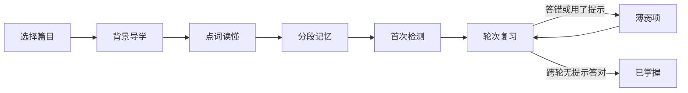

# 八年级上册语文必背古诗文学习器设计方案

## 1. 设计目标

将八年级上册语文必背内容制作成一套适合首次学习和后续巩固的 HTML 学习工具，而不是单纯扩充现有生字词卡。

核心学习闭环：



系统不按日期生成复习任务，而是根据实际掌握情况不断生成“下一轮”。掌握不好的内容会多练几轮，停止学习几天也不会产生新的逾期任务。

## 2. 内容范围

附件内容已经核对：

- 7 个教材课组
- 18 篇具体篇目
- 约 2018 字正文
- 169 个重点词
- 所有词语索引均能准确定位到正文中的首次出现位置

课组包括：

1. 《三峡》
2. 《短文二篇》（《答谢中书书》《记承天寺夜游》）
3. 《与朱元思书》
4. 《唐诗五首》
5. 《〈孟子〉三章》
6. 《愚公移山》
7. 《诗词五首》

组合课在页面中继续保留教材课组结构，但学习和进度记录下沉到每一篇具体课文或诗词。例如《唐诗五首》包含 5 个可以分别学习和掌握的篇目。

## 3. 产品结构

建议使用一个独立 HTML 页面完成整个学习体验，主要包含以下视图：

```text
八年级上册 · 必背古诗文
├─ 总览：继续学习、开始下一轮、总体进度
├─ 学习：背景导学、正文点词、分段记忆、首次检测
├─ 复习：系统组织的薄弱项轮次练习
└─ 全文：不影响进度的课文与注释浏览
```

不制作介绍性质的落地页。进入页面后直接显示当前最适合进行的学习操作。

## 4. 首页设计

### 4.1 顶部区域

- 返回学习卡片首页
- 标题“八年级上册 · 必背古诗文”
- `学习`、`复习`、`全文`三个模式切换入口
- 同步、导入、导出和重置功能收纳到“更多”菜单

移动端不在顶部并排展示所有工具按钮，避免现有页面在窄屏下出现标题被压缩和横向溢出。

### 4.2 核心操作

首页只突出两个主要动作：

- `继续学习`：返回上次学习的位置，或推荐下一篇未学习内容
- `开始下一轮复习`：从已学习内容中组织薄弱项和巩固项

### 4.3 进度展示

分别显示三类进度，避免仅以“打开过页面”代表掌握：

- 已学习篇目数
- 已掌握重点词数
- 已掌握背诵段数

每个篇目使用以下状态：

| 状态 | 含义 |
| --- | --- |
| 未学习 | 尚未进入首次学习 |
| 学习中 | 首次学习尚未完成 |
| 待巩固 | 已完成首次学习，尚未经过充分复习 |
| 复习中 | 有词语或背诵片段仍然薄弱 |
| 已掌握 | 已达到跨轮无提示答对标准 |

首页不显示日期、连续打卡天数或逾期项目。

## 5. 首次学习流程

每篇课文采用四步学习流程。孩子尚未在课堂上学过这些内容，因此首次进入时先帮助理解，再开始记忆和检测。

### 5.1 先了解

展示以下内容：

- 作者和文体
- 2 至 4 句写作背景
- 课文主要内容
- 情感或论证线索
- 本篇需要掌握的篇幅和重点词数量

导学内容控制在一屏以内。完整译文或详细解释默认折叠，避免首次进入时信息过载。

### 5.2 读原文

正文按照自然段、诗句或语义层次排版。重点词在首次出现位置做轻量标记。

点击重点词后：

- 桌面端在正文右侧显示释义
- 手机端从底部弹出释义
- 显示词语、解释和所在原句
- 可以跳转到“上一个重点词”或“下一个重点词”
- 可以统一显示或隐藏所有重点词标记

查看注释属于学习行为，但不会直接将词语标记为已掌握。

### 5.3 分段记

散文按照段落和语义拆分，诗歌按照联或句拆分。每段依次提供四种记忆强度：

1. 显示完整原文
2. 遮住重点词
3. 只保留首字和标点
4. 完全遮挡，自行背诵

背诵后可以展开原文核对，并选择：

- 完全想起
- 提示后想起
- 没想起

自评会影响后续复习优先级，但不能单独让内容进入“已掌握”。

### 5.4 学完测一下

首次检测只覆盖刚学习的内容，由浅到深组合以下题型：

- 词语与释义匹配
- 根据解释选择词语
- 原句重点词填空
- 上句接下句
- 诗句或语句排序
- 段落遮挡背诵

首次检测不要求全对才能结束。错误内容自动进入薄弱队列，之后在轮次复习中继续出现。

## 6. 轮次复习机制

### 6.1 基本原则

每个重点词和背诵片段分别记录掌握阶段：

```text
刚学过 → 有印象 → 较熟练 → 已掌握
```

系统记录学习轮次和作答结果，不保存“下次复习日期”。因此停学几天不会新增任务，也不会形成按日期累积的复习债务。

### 6.2 单轮规模

- 每轮约 8 至 12 题
- 每轮预计 8 至 12 分钟
- 薄弱项优先出现
- 较熟练内容少量抽查
- 每个项目在一轮中最多出现两次

单轮必须可以正常结束，不能因为连续答错形成无限循环。

### 6.3 升降级规则

- 无提示答对：掌握阶段提升一级
- 使用提示后答对：保持当前阶段
- 答错：降低一级并进入薄弱队列
- 答错后立即显示正确答案、原文位置和解释
- 错项间隔 3 至 5 题后换一种形式再练一次
- 同一内容需在两个不同轮次中无提示答对，才能进入“已掌握”
- 已掌握内容默认退出自动复习；以后抽查答错时退回“较熟练”

### 6.4 轮次结束

每轮结束后展示：

- 本轮完成数量
- 本轮升级数量
- 本轮新掌握数量
- 仍需巩固的内容
- `继续下一轮`和`返回总览`两个操作

不使用“今天必须完成”的表达。

## 7. 题型随掌握度变化

| 掌握阶段 | 主要题型 |
| --- | --- |
| 刚学过 | 词义选择、原文定位、带选项填空 |
| 有印象 | 词语填空、上下句选择、简单排序 |
| 较熟练 | 无选项填空、首字提示背诵 |
| 最终验收 | 整段遮挡、整首诗或整篇课文背诵自检 |

具体字词和原句填空由系统自动判断，判分时忽略空格及常见标点差异。

完整口头背诵无法在纯 HTML 中可靠自动评分，因此采用“遮挡背诵、展示原文、自行核对”的方式。最终掌握仍需结合可自动判断的字词和原句练习结果，不能只依赖自评。

## 8. 全文浏览模式

全文模式供自由阅读和临时查阅，不改变掌握进度。

主要功能：

- 按课组和具体篇目选择正文
- 显示作者和正文
- 显示或隐藏重点词标记
- 点击查看词语解释
- 展开简明译文、段落大意和背诵提示
- 快速进入当前篇目的学习或复习

## 9. 内容补充建议

附件已经提供正文、作者、词语解释和词语索引，但尚未包含完整的学习辅助内容。编码前建议为每篇补充：

- 写作背景
- 作者和文体简介
- 简明译文或逐段大意
- 篇章结构
- 内容、情感或论证线索
- 分段方案
- 背诵记忆提示
- 不同掌握阶段的练习题

这些辅助内容默认折叠，正文始终是页面的视觉主体。

## 10. 视觉设计

沿用现有语文字词页面的文化识别度，但优化信息层级和移动端体验。

### 10.1 视觉语言

- 背景使用浅暖灰，正文区域使用接近白色的纸张色
- 正文使用宋体或系统衬线字体，保证长文阅读清晰
- 标题和少量篇目标识使用楷体
- 朱砂红表示重点词和需要注意的内容
- 绿色表示已经掌握
- 琥珀色表示薄弱或需要巩固
- 控件使用无衬线字体

不使用大面积装饰、复杂渐变或大量卡片嵌套。

### 10.2 桌面端

桌面端采用三栏布局：

```text
篇目目录 | 课文正文与练习 | 注释、译文和学习状态
```

正文列保持适合古诗文阅读的行宽，目录和注释栏在滚动时保持可见。

### 10.3 手机端

- 单列正文布局
- 篇目选择使用抽屉或底部面板
- 词语解释使用底部面板
- 底部固定当前步骤需要的操作按钮
- 同步、导入、导出和重置放入“更多”菜单
- 保证标题、按钮和正文不会横向溢出

## 11. 进度与数据

建议分别保存以下进度：

- 每篇课文的首次学习步骤
- 每个重点词的掌握阶段、正确次数和错误次数
- 每个背诵片段的掌握阶段和自评结果
- 最近学习篇目和位置
- 当前复习轮次
- 每轮作答记录

首版继续采用浏览器本地存储，并接入项目现有的进度同步能力。内容和进度使用稳定 ID 关联，后续补充题目时不能导致原有进度失效。

## 12. 第一版范围

第一版包含：

1. 一个独立的八年级上册语文必背内容 HTML 页面
2. 7 个课组、18 篇具体篇目的浏览和学习
3. 正文重点词联动解释
4. 首次学习四步流程
5. 分段遮挡背诵
6. 重点词和原句自动练习
7. 不按日期的轮次复习
8. 本地进度保存及现有同步能力
9. 桌面端和手机端响应式适配
10. 首页增加对应学习入口

第一版暂不包含：

- 日期计划和到期任务
- 连续打卡
- 积分或排行榜
- 录音自动评分
- 账号体系改造
- 与本次语文学习无关的暑期任务模块

## 13. 待确认事项

1. 当前将用户所说的“背景课文内容”理解为“必背课文全文”，同时建议额外补充简短写作背景和译文帮助首次学习。
2. 是否允许在附件数据之外补充背景、译文、篇章结构、背诵提示和练习题。
3. 是否采用“跨两个不同轮次无提示答对”作为自动掌握的核心条件。
4. 是否维持现有的本地保存和同步码机制。

